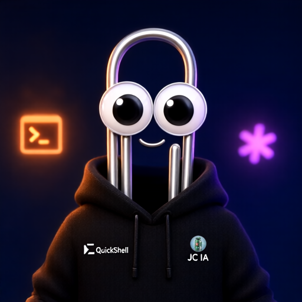
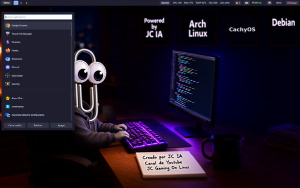
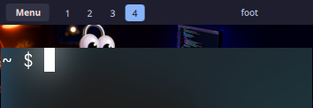
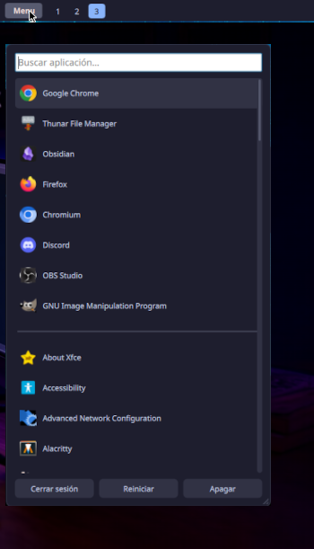
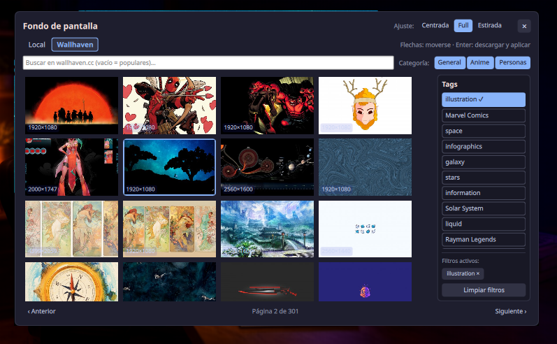
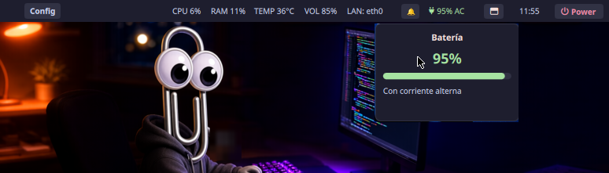
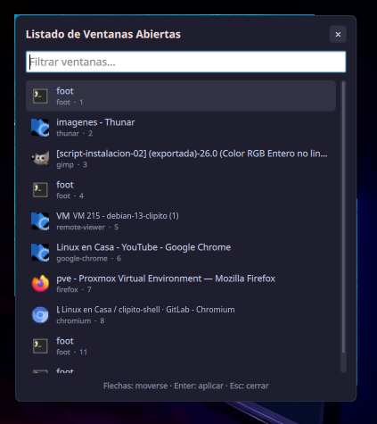
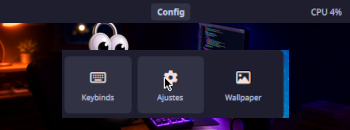
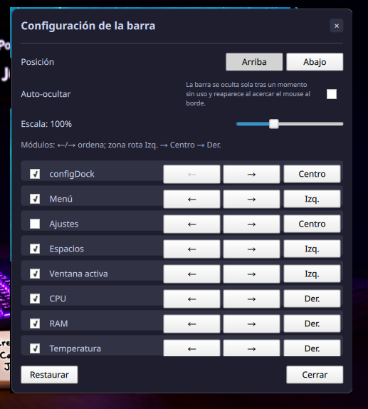

# Clipito Shell

**Un escritorio completo para tu compositor Wayland —barra, launcher, notificaciones, menú de energía, fondos de pantalla y más— con la misma experiencia en niri, Sway, Hyprland y mango.**



Hecho con [Quickshell](https://quickshell.org) · 
Software libre (GPLv3) · 
Script Desarrollado en su mayoría con Claude Code y mostrado en los directos de [**LinuxenCasa**](https://www.youtube.com/@LinuxenCasa)

> ### 🍴 Fork
> Este repo es un **fork** mantenido por **JC Gaming On Linux**
> ([https://www.youtube.com/@jcgamingonlinux](https://www.youtube.com/@jcgamingonlinux)), agrega fixes y mejoras
> en los scripts de instalación y sus menús (octubre de 2026), aplicadas y
> verificadas sobre el original.

> **Fixes de este fork (resumen):**
>
> 1. **[BLOQUEANTE] `01-install-arch.sh`:** el paquete `xorg` no existe en
>    Arch y abortaba la instalación base → corregido a `xorg-server`.
> 2. **`01-install-arch.sh`:** condición invertida al limpiar `/tmp/yay` y
>    `/tmp/paru` (re-ejecutar el script abortaba la instalación).
> 3. **`01-install-arch.sh` y `02-install-trixie.sh`:** no se copiaban las
>    configs de las terminales (kitty, alacritty, foot) según el compositor.
> 4. **Menús (los 3 scripts):** ahora advertir con las teclas si el usuario
>    confirma sin seleccionar nada (antes seguía con la sección vacía, sin avisar).
> 5. **Menús (los 3 scripts):** "Cancelar" cerraba el script (por `set -e`)
>    en vez de volver al menú principal — 60 llamadas a `dialog` protegidas.
> 6. **Aviso "WM primero" (los 3 scripts):** entrar a otra sección sin haber
>    elegido Window Manager muestra un aviso y vuelve al menú principal
>    (antes el script se cerraba).
> 7. **Fixes defensivos `set -e` (los 3 scripts):** estado viejo con claves
>    inexistentes en `load_state`, `$HOME` inexistente en `save_state` y
>    `hostnamectl` sin systemd en la Bienvenida — ya no matan el script.
> 8. **Cosméticos:** mensajes copy-paste corregidos (mango en forky, SDDM en el
>    caso ly) y créditos del fork en Leeme y Bienvenida.
> 9. **Créditos y descripción Full (los 3 scripts):** canal de YouTube
>    [@jcgamingonlinux](https://www.youtube.com/@jcgamingonlinux) agregado en
>    los créditos del header y en la Bienvenida; la descripción del pack
>    `full` ahora dice "BloatWare al más puro estilo Windows 11".
>
> Todos los fixes fueron verificados con harness unitarios contra el código
> real y pruebas en vivo. Detalles completos (causa, fix y verificación de
> cada uno): [NOTAS-FIXES.md](./NOTAS-FIXES.md)


> repo original:
> [linux-en-casa/claudito-shell](https://gitlab.com/linux-en-casa/claudito-shell) (GitLab),
> donde el script de instalación lo desarrolló **Gabriel Parri** (gabeeOS Linux).
>


**Funciona en:** [niri](https://github.com/YaLTeR/niri) · [Sway](https://swaywm.org) · [Hyprland](https://hyprland.org) (config Lua, 0.55+) · [mango](https://github.com/mangowm/mango)

**Ir directo a:** [Instalación](#instalación) · [Configuración](#configuración) · [Solución de problemas](#solución-de-problemas) · [Todas las características](#características-en-detalle)



## Por qué Clipito Shell

Clipito Shell no es solo una barra: es todo lo que un escritorio necesita, integrado, configurable desde su propia interfaz y con el mismo comportamiento sin importar el compositor que uses.

### Una sola instalación en lugar de muchas piezas sueltas

| Lo que necesitás | Lo que se suele instalar por separado | En Clipito Shell |
| --- | --- | --- |
| Barra | Waybar, swaybar | Barra integrada, con módulos que podés mover y ocultar |
| Lanzador de aplicaciones | Wofi, Rofi | Launcher integrado |
| Notificaciones | Mako, Dunst, SwayNC | Servidor de notificaciones y centro con historial |
| Menú de apagar / reiniciar | wlogout | Menú de energía integrado |
| Fondo de pantalla | swaybg, hyprpaper, swww | Selector de fondos (local + Wallhaven) que también lo dibuja |
| Cambiar entre ventanas abiertas | `rofi -show window` | Listado de ventanas abiertas |

Todo comparte el mismo diseño y es una única configuración de Quickshell para mantener.

### Lo que ganás

- **La misma experiencia en cuatro compositores.** Mismo diseño, mismos módulos, mismos atajos (`Super+Alt+letra`) y mismos comandos IPC en niri, Sway, Hyprland y mango. Si probás otro compositor, no empezás de cero.
- **Se configura con el mouse, sin tocar código.** Desde el panel de Ajustes elegís si la barra va arriba o abajo, activás el auto-ocultado, ajustás la escala (70 %–160 %) y decidís qué módulos se ven, en qué zona y en qué orden. Todo se guarda solo, y hay un botón para volver a los valores originales.
- **No te quedás afuera de tus propios ajustes.** Si ocultás el botón de Ajustes, siempre quedan un atajo de teclado (`Super+Alt+,`) y un comando IPC para volver a abrir el panel.
- **Se adapta a tus pantallas.** Cada monitor calcula su propia escala según su resolución —por ejemplo, un 1360×768 junto a un 4K— y las ventanas emergentes y las notificaciones aparecen en la pantalla que tiene el foco.
- **Rápido para lo que más usás.** El launcher muestra al instante tus 8 aplicaciones más usadas y busca el resto en vivo mientras escribís; una app recién instalada aparece sin cerrar sesión.
- **Fondos de pantalla sin salir del escritorio.** Elegí una imagen local o buscá en [Wallhaven](https://wallhaven.cc) (sin cuenta ni API key). Con ImageMagick instalado, cada descarga se ajusta a la resolución de tu pantalla más grande: no se ve borrosa ni ocupa espacio de más.
- **Tus atajos siempre a la vista.** El visor de atajos (`Super+Alt+K`) lee los binds directamente del archivo de configuración de tu compositor, así que nunca queda desactualizado.
- **También sin systemd.** El menú de energía prueba `systemctl`, luego `loginctl` (elogind) y, como último recurso, el comando directo: pensado para funcionar también en distribuciones como Alpine.
- **Software libre.** Licencia GPLv3: podés usarlo, estudiarlo, modificarlo y compartirlo.

## Índice

- [Por qué Clipito Shell](#por-qué-clipito-shell)
- [Instalación](#instalación)
  - [Compatibilidad](#compatibilidad)
  - [Requisitos](#requisitos)
  - [Opción A: scripts de instalación](#opción-a-scripts-de-instalación)
  - [Opción B: instalación manual](#opción-b-instalación-manual)
- [Configuración](#configuración)
  - [Panel de Ajustes](#panel-de-ajustes)
  - [Dónde se guardan tus ajustes](#dónde-se-guardan-tus-ajustes)
  - [Fondo de pantalla](#fondo-de-pantalla)
  - [Atajos de teclado por defecto](#atajos-de-teclado-por-defecto)
  - [Comandos IPC de Quickshell](#comandos-ipc-de-quickshell)
- [Solución de problemas](#solución-de-problemas)
- [Características en detalle](#características-en-detalle)
- [Estructura del repo](#estructura-del-repo)
- [Notas y limitaciones conocidas](#notas-y-limitaciones-conocidas)
- [Sobre el proyecto](#sobre-el-proyecto)
- [Créditos](#créditos)
- [Licencia](#licencia)

## Instalación

Hay dos caminos: los **scripts de instalación** (Arch y Debian) o la **instalación manual** (cualquier distribución): instalar los requisitos, copiar una carpeta, pegar un snippet en la configuración de tu compositor y arrancar.

### Compatibilidad

Cada compositor tiene su propia carpeta autocontenida (una "variante"), con los mismos módulos y el mismo diseño:

| Compositor | Carpeta | Archivo de configuración donde va el snippet | Snippet incluido |
| --- | --- | --- | --- |
| [niri](https://github.com/YaLTeR/niri) | `niri-bar/` | `~/.config/niri/config.kdl` | `niri-config-snippet.kdl` |
| [Sway](https://swaywm.org) | `sway-bar/` | `~/.config/sway/config` | `sway-config-snippet.conf` |
| [Hyprland](https://hyprland.org) 0.55+ (config Lua) | `hyprland-bar/` | `~/.config/hypr/hyprland.lua` | `hyprland-config-snippet.lua` |
| Hyprland con `hyprland.conf` clásico | `hyprland-bar/` | `~/.config/hypr/hyprland.conf` | `hyprland-config-snippet-legacy.conf` |
| [mango](https://github.com/mangowm/mango) | `mango-bar/` | `~/.config/mango/config.conf` | `mango-config-snippet.conf` |

Probado durante los directos en **Debian 13 Trixie**, **Debian 14 Forky** y **Arch Linux**. También puede funcionar en Gentoo, Void y Alpine.

### Requisitos

Necesarios siempre:

| Componente | Para qué se usa | Arch | Debian |
| --- | --- | --- | --- |
| **Quickshell** | Es la base de la shell. Hace falta una versión reciente: se usan sus módulos de Bluetooth, UPower, PipeWire, bandeja del sistema y notificaciones. | `quickshell` | `quickshell` (en Debian 14 Forky, de los repos oficiales) |
| **JetBrainsMono Nerd Font** | Íconos de la barra y de los menús | `ttf-jetbrains-mono-nerd` | Descarga manual (ver abajo) |

Según los módulos que uses:

| Componente | Para qué se usa | Arch | Debian |
| --- | --- | --- | --- |
| PipeWire + WirePlumber | Módulo de volumen y teclas multimedia (`wpctl`) | `pipewire wireplumber` | `pipewire wireplumber` |
| UPower | Módulo de batería | `upower` | `upower` |
| BlueZ | Módulo de Bluetooth (solo aparece si hay un adaptador) | `bluez bluez-utils` | `bluez` |
| swaylock | Botón "Bloquear" del menú de energía y del launcher | `swaylock` | `swaylock` |
| curl (o wget) | Búsqueda y descarga de fondos de Wallhaven | `curl` | `curl` |
| ImageMagick *(opcional)* | Reduce los fondos de Wallhaven a la resolución de tu pantalla más grande (sin él se guardan igual, en tamaño original) | `imagemagick` | `imagemagick` |
| NetworkManager *(opcional)* | Nombre de la red conectada (sin él, la conexión se detecta igual por `/sys/class/net`) | `networkmanager` | `network-manager` |
| sound-theme-freedesktop *(opcional)* | Sonido de las alertas de batería baja | `sound-theme-freedesktop` | `sound-theme-freedesktop` |
| socat *(Hyprland)* | Workspaces y ventana activa se actualizan al instante (sin él, con un sondeo cada 2 segundos) y `hide-on-fullscreen.sh` | `socat` | `socat` |
| brightnessctl *(opcional)* | Teclas de brillo en portátiles (líneas opcionales del snippet) | `brightnessctl` | `brightnessctl` |


### Opción A: scripts de instalación


> **Advertencia:** los scripts están en período de prueba.

Son scripts en bash que usan `dialog` para los menús interactivos. Descargá el repositorio y ejecutá el que corresponda a tu distribución:

```sh
git clone https://github.com/jcgamingonlinux/clipito-shell.git
cd clipito-shell
bash 01-install-arch.sh        # Arch Linux
# bash 02-install-trixie.sh    # Debian 13 Trixie
# bash 03-install-forky.sh     # Debian 14 Forky
```

Ese es el fork corregido (el de este repo). El repo original, sin estos
fixes: [gitlab.com/linux-en-casa/claudito-shell](https://gitlab.com/linux-en-casa/claudito-shell).

| Script | Distribución | Compositores que se pueden instalar | Notas |
| --- | --- | --- | --- |
| `01-install-arch.sh` | Arch Linux | Hyprland, Niri y Sway | Tiene activada la opción "restore" (función en pruebas). [Video](https://youtu.be/N2-x7Fws1kY) |
| `02-install-trixie.sh` | Debian 13 Trixie | Hyprland, Niri y Sway | Incluye la función "restore" y activa los repos de Trixie-backports. [Video](https://youtu.be/ywDWw6bxGRQ) |
| `03-install-forky.sh` | Debian 14 Forky | Hyprland, Mango, Niri y Sway | Usa la versión de Quickshell de los repos oficiales de Debian Forky. |


### Opción B: instalación manual

Sirve para cualquier distribución.

#### Paso 1. Instalá los requisitos

Ver [Requisitos](#requisitos).

#### Paso 2. Copiá la variante de tu compositor

Copiá la carpeta de tu variante a una subcarpeta con nombre dentro de `~/.config/quickshell/`:

```sh
mkdir -p ~/.config/quickshell
cp -r niri-bar ~/.config/quickshell/     # o sway-bar, hyprland-bar, mango-bar
```

Debe quedar `~/.config/quickshell/niri-bar/shell.qml` (cambiando el nombre según tu variante). Con este esquema todos los comandos usan `qs -c niri-bar ...`, y podés tener las cuatro variantes instaladas al mismo tiempo sin que se pisen: los snippets de cada compositor ya vienen armados así.

`qs` es el binario de Quickshell (alias corto habitual). Si en tu sistema el binario se llama `quickshell` en vez de `qs`, reemplazalo en los snippets y en los comandos de esta guía.

#### Paso 3. Pegá el snippet en la configuración de tu compositor

Abrí el snippet de tu variante (ver la tabla de [Compatibilidad](#compatibilidad)) y **pegá su contenido dentro de tu configuración existente**: se agrega, no la reemplaza. Aclaraciones por compositor:

- **niri:** si ya tenés un bloque `binds { }`, copiá solo las líneas de adentro en tu bloque.
- **Sway:** comentá o eliminá el bloque `bar { ... }` predeterminado, porque Quickshell reemplaza a swaybar por completo.
- **Hyprland:** con la config Lua nueva (0.55+) usá `hyprland-config-snippet.lua`. Con el `hyprland.conf` clásico usá `hyprland-config-snippet-legacy.conf` y cambiá `configPath` en `hyprland-bar/modules/KeybindsPopup.qml` de `hyprland.lua` a `hyprland.conf`, para que el visor de atajos lea el archivo correcto.
- **mango:** el snippet también agrega `Ctrl+Shift+1..9` para el multiview de tags (ver [Características en detalle](#características-en-detalle)).

#### Paso 4. Arrancá Quickshell con `launch-with-icon-theme.sh` (recomendado)

Este script detecta el tema de íconos GTK activo y lo exporta como `QS_ICON_THEME` antes de arrancar Quickshell, para que los íconos de las apps se vean igual que en el resto de tu sistema. Los snippets de niri, Sway y Hyprland arrancan `qs` directamente: reemplazá esa línea de arranque por la que corresponde en esta tabla (el snippet de mango ya usa el script).

| Compositor | Línea de arranque recomendada |
| --- | --- |
| niri | `spawn-at-startup "sh" "-c" "sh ~/.config/quickshell/niri-bar/launch-with-icon-theme.sh"` |
| Sway | `exec_always pkill -f "qs -c sway-bar"; exec sh ~/.config/quickshell/sway-bar/launch-with-icon-theme.sh` |
| Hyprland (Lua) | `hl.exec_cmd("sh ~/.config/quickshell/hyprland-bar/launch-with-icon-theme.sh")` (dentro de `hl.on("hyprland.start", ...)`) |
| Hyprland (clásico) | `exec-once = sh ~/.config/quickshell/hyprland-bar/launch-with-icon-theme.sh` |
| mango | `exec-once = sh ~/.config/quickshell/mango-bar/launch-with-icon-theme.sh` (ya viene en el snippet) |

#### Paso 5. Dejá un solo servidor de notificaciones

Quickshell se registra como servidor de notificaciones del sistema (D-Bus `org.freedesktop.Notifications`) y solo puede haber uno activo. Si tenías mako, dunst, swaync u otro, desinstalalo o desactivá su autostart.

#### Paso 6. Cerrá sesión y volvé a entrar

Para probarlo sin reiniciar la sesión, corré en una terminal dentro de tu sesión Wayland `sh ~/.config/quickshell/niri-bar/launch-with-icon-theme.sh` (o `qs -c niri-bar`), cambiando el nombre de la carpeta según tu variante. Si algo falla, el error se imprime en esa terminal.

#### Opcional: ocultar la barra en pantalla completa

- **Hyprland:** agregá `hide-on-fullscreen.sh` a tu autostart (necesita `socat`). Con la config clásica es `exec-once = sh ~/.config/quickshell/hyprland-bar/hide-on-fullscreen.sh`; con la config Lua, agregalo con `hl.exec_cmd(...)` junto a la línea de arranque de Quickshell.
- **mango:** `exec-once = sh ~/.config/quickshell/mango-bar/hide-on-fullscreen.sh` (usa `mmsg`, que ya viene con mango).

Ver el README de cada carpeta para más detalle.

Cada carpeta tiene su propio `README.md` con el detalle completo de cada cambio hecho durante el desarrollo, por si hace falta rastrear el porqué de alguna decisión puntual.

## Configuración

La mayor parte de la configuración se hace desde la propia shell, sin editar archivos.

### Panel de Ajustes

Abrilo con el botón **Ajustes** de la barra, desde el Dock de Configuración, con `Mod+Alt+,` o por línea de comandos: `qs -c <carpeta> ipc call bar-config toggle`.

| Opción | Qué hace |
| --- | --- |
| **Posición** | Barra arriba o abajo. Los popups (launcher, calendario, etc.) se anclan del mismo lado. |
| **Auto-ocultar** | La barra se repliega sola tras un momento sin uso y reaparece al acercar el mouse al borde de la pantalla; el espacio se libera para otras ventanas. También se alterna con `Mod+Alt+B`. |
| **Escala** | De 70 % a 160 % (de a 5 %), aplicada sobre la escala automática que ya calcula cada pantalla. |
| **Módulos** | Una casilla para mostrar u ocultar cada módulo, flechas ← / → para reordenarlo y un botón para cambiarlo de zona (Izquierda → Centro → Derecha). |
| **Restaurar** | Vuelve la barra a sus valores originales. |

El propio botón de Ajustes es un módulo más: se puede mover u ocultar. Si ocultás **Ajustes** y **Config** a la vez, el panel te avisa; para volver a abrirlo usá el atajo `Mod+Alt+,` o el comando IPC de arriba, que funcionan siempre.

### Dónde se guardan tus ajustes

Todo se guarda en `~/.config/quickshell/`:

| Archivo | Qué guarda |
| --- | --- |
| `bar-layout.tsv` | Posición, escala, auto-ocultar y módulos de la barra (en `mango-bar`, el archivo es `mango-bar-layout.tsv`) |
| `wallpaper-path.txt` | Fondo de pantalla actual |
| `wallpaper-fillmode.txt` | Ajuste de la imagen (centrada, full o estirada) |
| `launcher-size.txt` | Tamaño del launcher del botón Menú |

Las variantes de niri, Sway y Hyprland usan los mismos archivos, así que tus ajustes te siguen de un compositor a otro; `mango-bar` guarda su propio layout. Para llevarte tu configuración a otra máquina, copiá estos archivos.

### Fondo de pantalla

- Abrí el selector con `Mod+Alt+W` o desde el Dock de Configuración.
- Poné tus imágenes en `~/wallpapers` (se leen hasta 2 niveles de subcarpetas) o descargalas desde la pestaña **Wallhaven**, que las guarda en `~/wallpapers/wallhaven/`.
- Elegí cómo se ajusta la imagen a la pantalla: **Centrada** (tamaño original), **Full** (recorta y llena toda la pantalla) o **Estirada** (llena exacto sin mantener proporción).

Ver [Selector de fondo de pantalla](#selector-de-fondo-de-pantalla) para todos los detalles.

### Atajos de teclado por defecto

Definidos en el snippet de cada compositor — cambialos ahí si no te
acomodan. `Mod` es la tecla Super/Windows por defecto.

| Atajo                                           | Acción                                     |
| ----------------------------------------------- | ------------------------------------------ |
| `Mod+Alt+D`                                     | Abrir/cerrar launcher                      |
| `Mod+Shift+X`                                   | Abrir/cerrar menú de energía               |
| `Mod+Alt+W`                                     | Abrir/cerrar selector de fondo de pantalla |
| `Mod+Alt+K`                                     | Abrir/cerrar visor de atajos               |
| `Mod+Alt+C`                                     | Abrir/cerrar Dock de Configuración         |
| `Mod+Alt+Tab`                                   | Listado de ventanas abiertas               |
| `Mod+Alt+Comma`                                 | Abrir/cerrar Ajustes de la barra           |
| `Mod+Alt+B`                                     | Prender/apagar auto-ocultar la barra       |
| `XF86AudioRaiseVolume` / `LowerVolume` / `Mute` | Volumen                                    |
| `XF86AudioMicMute`                              | Silenciar micrófono                        |

En **mango**, además, `Ctrl+Shift+1..9` suma o saca el tag N de la vista actual (multiview).
`Ctrl+1..9` (ver el tag N) y `Alt+1..9` (mover la ventana al tag N) son atajos por defecto
de mango, no de este snippet.

El visor de atajos (botón ⌨ / `Mod+Alt+K`) lee estos mismos binds
directamente del archivo de config del compositor, así que si agregás
más marcándolos con un comentario `@title` (y opcionalmente
`@category`), aparecen ahí automáticamente.

### Comandos IPC de Quickshell

Todos los popups/paneles se pueden abrir, cerrar o alternar por línea de
comandos con `qs -c <nombre> ipc call <target> <función>`, donde
`<nombre>` es la carpeta donde instalaste esa variante (`niri-bar`, `sway-bar`, `hyprland-bar` o `mango-bar`) — así podés tener las 4 variantes instaladas
al mismo tiempo sin que se pisen entre sí. `qs` es el binario de
quickshell (si en tu sistema se llama `quickshell` en vez de `qs`, usá
ese nombre). Útil para atajos de teclado propios o para recuperar algo
que hayas ocultado desde Ajustes.

| Target           | Función                    | Qué hace                                                                                                                                                                                          |
| ---------------- | -------------------------- | ------------------------------------------------------------------------------------------------------------------------------------------------------------------------------------------------- |
| `launcher`       | `toggle`                   | Abre/cierra el launcher centrado (atajo de teclado)                                                                                                                                               |
| `powermenu`      | `toggle`                   | Abre/cierra el menú de energía centrado                                                                                                                                                           |
| `wallpaper`      | `toggle`                   | Abre/cierra el selector de fondo de pantalla                                                                                                                                                      |
| `keybinds`       | `toggle`                   | Abre/cierra el visor de atajos de teclado                                                                                                                                                         |
| `config-dock`    | `toggle`                   | Abre/cierra el Dock de accesos rápidos (Keybinds / Ajustes / Wallpaper)                                                                                                                           |
| `windowlist`     | `toggle`                   | Abre/cierra el listado de ventanas abiertas                                                                                                                                                       |
| `bar-config`     | `toggle`                   | Abre/cierra el panel de Ajustes de la barra                                                                                                                                                       |
| `autohide`       | `toggle`                   | Prende/apaga la preferencia de auto-ocultar la barra                                                                                                                                              |
| `bar-visibility` | `hide` / `show` / `toggle` | Fuerza a la barra a ocultarse/mostrarse, sin tocar la preferencia de auto-ocultado (pensado para engancharlo a eventos externos, ej. fullscreen)                                                  |
| `app-list`       | `rescan`                   | Refresca a mano el listado completo de apps del launcher (por si instalaste algo y no querés esperar al próximo login)                                                                            |
| `panic`          | `closeAll`                 | Cierra TODOS los popups de la barra, incluidos los que viven en la capa Overlay (Wallpaper, Atajos, Listado de ventanas) — útil para anteponerlo a un atajo de captura de pantalla, ver más abajo |

Ejemplo (instalado en `~/.config/quickshell/sway-bar/`):

```sh
qs -c sway-bar ipc call bar-config toggle
```

## Solución de problemas

| Síntoma | Causa probable | Qué hacer |
| --- | --- | --- |
| La barra no aparece | Quickshell no arrancó o falló al cargar | Corré `qs -c <carpeta>` en una terminal para ver el error. Verificá que exista `~/.config/quickshell/<carpeta>/shell.qml` y que la línea de arranque esté en la config de tu compositor. En Sway, verificá que desactivaste el bloque `bar { ... }`. |
| En vez de íconos veo cuadrados o símbolos raros | Falta JetBrainsMono Nerd Font | Instalala (ver [Requisitos](#requisitos)) y reiniciá Quickshell. |
| Los íconos de las apps aparecen como un círculo con la inicial | Qt no sabe qué tema de íconos usar | Arrancá con `launch-with-icon-theme.sh` (ver más abajo). |
| No veo notificaciones | Otro servidor de notificaciones (mako, dunst, swaync...) activo | Desinstalalo o desactivalo: solo puede haber uno. |
| El botón Bloquear no hace nada | Falta `swaylock` | Instalalo. |
| La alerta de batería aparece pero no suena | Falta `sound-theme-freedesktop` | Instalalo. |
| No aparece el módulo de Bluetooth | Solo se muestra si se detecta un adaptador | Verificá que el adaptador exista y que BlueZ esté instalado y activo. |
| Las teclas de volumen no responden | Los binds del snippet usan `wpctl` | Instalá PipeWire + WirePlumber, o cambiá los binds por tu propio comando. |
| Ocultaste Ajustes y Config y no podés abrir el panel | — | Usá `Mod+Alt+,` o `qs -c <carpeta> ipc call bar-config toggle`. |
| Hyprland: los workspaces se actualizan con retraso | Falta `socat` (hay un sondeo de respaldo cada 2 segundos) | Instalá `socat`. |
| Hyprland: la barra queda por encima de una ventana en pantalla completa | Según versión y configuración, Hyprland no siempre la oculta | Usá `hide-on-fullscreen.sh` (ver [Instalación](#opcional-ocultar-la-barra-en-pantalla-completa)). |

### Íconos que no cargan (tema de íconos)

- Si algunos íconos de apps no cargan (quedan como un círculo con la
  inicial) aunque el tema esté instalado y otras apps (rofi, GTK) sí lo
  vean, es porque Quickshell/Qt no tiene configurado qué tema de íconos
  usar — común en sesiones niri/sway/Hyprland/mango sin `qt5ct`/`qt6ct`.
- Cada carpeta incluye `launch-with-icon-theme.sh`: detecta el tema de
  íconos GTK activo y lo exporta como `QS_ICON_THEME` antes de arrancar
  quickshell. Usalo en tu autostart en vez de llamar a `quickshell`
  directamente.

## Características en detalle

Todo lo que incluye Clipito Shell, módulo por módulo.

### La barra en sí

- **Posición configurable**: arriba o abajo, desde el panel de Ajustes.
- **Escala automática por pantalla**: cada monitor calcula su propio factor
  de escala según su resolución — con varios monitores de resoluciones
  distintas (ej. 1360×768 y 4K), cada barra se ve bien en la suya, de
  forma independiente.
- **Escala ajustable**: además de la automática, podés subir o bajar el tamaño de
  toda la interfaz entre 70 % y 160 % desde el panel de Ajustes.
- **Módulos reordenables y ocultables**: cada elemento de la barra
  (workspaces, reloj, CPU, RAM, red, batería, bluetooth, etc.) se puede
  mover entre zona izquierda/centro/derecha, reordenar dentro de su zona,
  u ocultar — todo desde el panel de Ajustes, sin tocar código.
- **El propio botón de Ajustes es un módulo más**: se puede reposicionar
  u ocultar igual que cualquier otro. Si lo ocultás, siempre queda el
  atajo de teclado y el comando IPC como respaldo (ver más abajo).
- **Auto-ocultar** (opcional): la barra se repliega sola tras un momento
  sin uso y reaparece acercando el mouse al borde de la pantalla. El
  espacio se libera para que otras ventanas puedan usarlo.
- **Ventanas emergentes que siguen la posición de la barra**: si la barra
  está abajo, los popups (launcher, calendario, etc.) se anclan abajo
  también, y viceversa.





### Módulos disponibles

| Módulo              | Qué muestra                      | Al hacer click                                                   |
| ------------------- | -------------------------------- | ---------------------------------------------------------------- |
| Ajustes             | —                                | Abre el panel de configuración de la barra                       |
| Config              | —                                | Abre el Dock de accesos rápidos (Keybinds / Ajustes / Wallpaper) |
| Menú                | Ícono de aplicaciones            | Abre el launcher                                                 |
| Workspaces          | Espacios de trabajo, clickeables | Cambia de workspace                                              |
| Ventana activa      | Ícono y título de la ventana con foco    | —                                                                |
| CPU                 | % de uso                         | Uso por hilo, con scroll                                         |
| RAM                 | % de uso                         | Detalle de memoria usada/disponible                              |
| Temperatura         | Temperatura principal            | Todas las zonas térmicas, con scroll                             |
| Volumen             | % de volumen                     | Control de volumen                                               |
| Red                 | Estado de conexión               | Detalle de red                                                   |
| Bandeja del sistema | Íconos de apps en bandeja        | Menú contextual de cada ícono                                    |
| Notificaciones      | Contador de no leídas            | Centro de notificaciones                                         |
| Atajos              | ⌨                                | Visor de atajos de teclado configurados                          |
| Batería             | % + AC/BAT, color según nivel    | Estado detallado (con/sin corriente, crítico)                    |
| Bluetooth           | Estado + dispositivo conectado   | Encender/apagar, conectar/desconectar dispositivos               |
| Listado de ventanas | 🗗                               | Buscador de ventanas abiertas, como `rofi -show window`          |
| Reloj               | Hora/fecha                       | Calendario                                                       |
| Energía             | Ícono de power                   | Cerrar sesión / reiniciar / apagar                               |

En **mango**, los workspaces son los 9 tags estilo dwm: click izquierdo en un tag para ver
solo ese tag; click derecho para sumarlo o sacarlo de la vista actual (multiview). Por
teclado, `Ctrl+Shift+1..9` hace lo mismo que el click derecho.

### Launcher de aplicaciones



- Dos formas de abrirlo: botón "Menú" de la barra, o atajo de teclado
  (centrado en pantalla).
- El launcher del botón "Menú" se puede redimensionar arrastrando con el mouse desde sus
  bordes y recuerda el tamaño entre sesiones. El launcher centrado (atajo de teclado)
  tiene tamaño fijo.
- Al escanear las apps instaladas una sola vez por sesión, las 8 usadas
  con más frecuencia se fijan de una vez (no se recalculan ni reordenan
  mientras seguís usando el equipo) y aparecen de inmediato, separadas
  del resto por una línea. Siguen apareciendo aunque las desinstales
  durante la sesión.
- El resto de las apps se sigue buscando y actualizando en cada apertura
  (para que una app recién instalada aparezca sin esperar el próximo
  login), ordenadas alfabéticamente debajo de la línea.
- Búsqueda en vivo, navegación con flechas, Enter para lanzar.

### Selector de fondo de pantalla



- Dos pestañas: **Local** (imágenes en `~/wallpapers`, hasta 2 niveles de
  subcarpetas) y **Wallhaven** (busca en [wallhaven.cc](https://wallhaven.cc)
  en vivo, usando su API pública — no hace falta cuenta ni API key).
- En Wallhaven: buscador de texto libre (vacío = populares del último
  mes) y filtro de categoría (General / Anime / Personas, combinables
  entre sí). Solo se muestra contenido SFW — fijo, sin opción de
  cambiarlo.
- Panel de tags a la derecha de los resultados, derivados de la
  búsqueda actual (no de una lista fija): se pueden seleccionar varios a
  la vez para combinarlos como filtro, sacarlos individualmente, o
  limpiarlos todos con un botón sin perder el texto buscado ni las
  categorías.
- Solo se cierra con Escape o su botón X — un click afuera no lo cierra
  (a diferencia del launcher y otros popups centrados).
- Antes de mostrar resultados, se detecta la resolución física real
  (contemplando escalado HiDPI) de **todas** las pantallas conectadas y
  se usa la más grande como filtro mínimo, para no ofrecer nada que se
  vería borroso al escalarlo.
- Al elegir una imagen de Wallhaven, se descarga a `~/wallpapers/wallhaven/`
  (se crea sola si hace falta) y, antes de guardarla, se reduce de
  verdad su resolución a la máxima detectada entre tus pantallas si hay
  **ImageMagick** (`convert` o `magick`) instalado — nunca la agranda, y
  mantiene la proporción original sin recortar ni distorsionar. Si no
  tenés ImageMagick instalado, se guarda igual pero al tamaño original
  (sigue funcionando perfecto, solo pesa más de lo necesario). Si ya la
  habías descargado antes, no la vuelve a bajar. Queda disponible
  también desde la pestaña Local de ahí en adelante.
- Ajuste de imagen, independiente de qué pestaña la hayas elegido:
  **Centrada** (tamaño original, sin escalar), **Full** (recorta y
  llena toda la pantalla), **Estirada** (llena exacto sin mantener
  proporción).

### Notificaciones

- Toasts que aparecen en la pantalla que tiene el foco (no en una fija),
  y centro de notificaciones con historial.
- Quickshell se registra como servidor de notificaciones del sistema
  (D-Bus `org.freedesktop.Notifications`) — si tenías otro daemon
  (dunst, mako, swaync...) hay que desinstalarlo o desactivarlo para que
  quickshell pueda tomar el registro.

### Batería



- Ícono + porcentaje, con la palabra **AC** (con corriente) o **BAT**
  (a batería), coloreado según el nivel: verde (80-100%), amarillo
  (50-80%), ámbar (30-50%), rojo (menos de 30%).
- Notificación al conectar/desconectar el cargador.
- Alertas sonoras de batería baja, solo mientras se está descargando (no
  suenan en AC/cargando), al cruzar 80%, 50%, 30%, 20%, 15%, 10% y 5%
  (usa `canberra-gtk-play`, `paplay` o `pw-play`, lo que haya
  disponible). Requiere tener instalado el paquete
  `sound-theme-freedesktop` (trae el sonido de aviso que se usa acá) —
  sin él no suena nada aunque el resto de la alerta (notificación) sí
  aparezca.
- Ventana de detalle al hacer click: porcentaje, barra de progreso, y
  estado en texto (con corriente / cargando / descargando / crítico).

### Bluetooth


- Solo aparece en la barra si se detecta un adaptador de Bluetooth.
- Ícono en el azul característico de la marca Bluetooth (`#0082FC`)
  cuando el adaptador está encendido, gris cuando está apagado.
- Encender/apagar el adaptador, ver dispositivos, conectar/desconectar,
  buscar dispositivos nuevos cercanos (8s de escaneo).
- Emparejar un dispositivo por primera vez todavía requiere
  `bluetoothctl` o el gestor de sistema — este panel maneja los ya
  emparejados.

### Listado de ventanas abiertas



- Equivalente a `rofi -show window`: ventana centrada con buscador,
  navegación por flechas y Enter/click para ir a esa ventana.
- Atajo de teclado dedicado (ver tabla de atajos) además del botón en
  la barra y Dock de Configuración.

### Dock de Configuración



- Módulo "Config" en la barra (zona centro por defecto): al hacer click
  o con su atajo de teclado (ver tabla de atajos) despliega un dock
  horizontal con 3 accesos directos — **Keybinds**, **Ajustes** y
  **Wallpaper** — que abren el popup correspondiente.
- Se navega con las flechas ← → y se acepta con Enter (Esc cierra).
- Se ancla debajo (o encima, si la barra está abajo) del propio módulo
  Config, igual que las cajas de info de CPU/RAM: si movés el módulo de
  zona, el dock lo sigue.



## Estructura del repo

```
.
├── README.md              (este archivo)
├── niri-bar/
│   ├── shell.qml
│   ├── modules/            (todos los componentes QML)
│   ├── niri-config-snippet.kdl
│   ├── launch-with-icon-theme.sh
│   └── README.md           (historial detallado de esta variante)
├── mango-bar/
│   ├── shell.qml
│   ├── modules/
│   ├── mango-config-snippet.conf
│   ├── launch-with-icon-theme.sh
│   ├── hide-on-fullscreen.sh
│   └── README.md
├── sway-bar/
│   ├── shell.qml
│   ├── modules/
│   ├── sway-config-snippet.conf
│   ├── launch-with-icon-theme.sh
│   └── README.md
└── hyprland-bar/
    ├── shell.qml
    ├── modules/
    ├── hyprland-config-snippet.lua
    ├── hyprland-config-snippet-legacy.conf
    ├── launch-with-icon-theme.sh
    ├── hide-on-fullscreen.sh
    └── README.md
```

## Notas y limitaciones conocidas

- **Hyprland 0.55+ (config Lua)**: `hyprctl dispatch` cambió de sintaxis
  — ya no acepta el formato viejo `dispatcher arg`, ahora evalúa una
  expresión Lua completa (`hl.dispatch(...)`). Los comandos de esta barra
  (cambiar de workspace, enfocar una ventana) ya están adaptados a la
  sintaxis nueva. Si en el futuro algo de esto deja de andar tras
  actualizar Hyprland, revisá primero si cambió de nuevo la sintaxis de
  `hyprctl dispatch`.
- **Hyprland + fullscreen**: por versión/configuración, Hyprland a veces
  no oculta automáticamente la barra al entrar a pantalla completa real.
  `hide-on-fullscreen.sh` es un respaldo explícito para eso (necesita
  `socat`).
- **Hyprland + UWSM**: si tu sesión usa UWSM, el dispatcher `exit` de
  Hyprland puede no cerrar sesión correctamente — puede hacer falta
  `uwsm stop` o `loginctl terminate-user` en su lugar.
- **Suspender/Reiniciar/Apagar sin systemd**: el menú de energía y los
  botones del launcher prueban, en orden, `systemctl` → `loginctl`
  (sistemas sin systemd pero con `elogind`, ej. Alpine) → el comando
  directo (`reboot`/`poweroff`/`pm-suspend`) como último recurso para
  SysV puro sin `elogind`. A diferencia de las primeras dos opciones
  (que pasan por polkit), ese último recurso normalmente necesita
  privilegios — si tu sistema no tiene sudo/doas sin contraseña
  configurado para esos comandos, van a fallar. Tampoco hay un comando
  de suspender universal ahí: `pm-suspend` es el más parecido a un
  estándar en SysV/OpenRC tradicional, pero no está garantizado en
  todos lados.
- **Multi-monitor con resoluciones muy distintas**: ya resuelto (cada
  pantalla escala independientemente), pero si agregás un monitor nuevo
  en caliente, puede hacer falta reiniciar quickshell para que tome bien
  su resolución si el compositor no notifica el cambio a tiempo.
- **Sway + multi-monitor**: los popups (launcher, calendario, menús,
  etc.) se cierran solos al hacer click afuera, incluso en otra
  pantalla — pero en Sway, un click en una pantalla sin ventanas (fondo
  vacío) no siempre hace que `swaymsg` reporte esa pantalla como
  enfocada (el foco de Sway sigue a las ventanas/contenedores, no al
  puntero). Ya hay una ventana "atajaclicks" invisible en cada pantalla
  no enfocada mientras un popup está abierto, así que esto ya está
  resuelto de fábrica; queda anotado acá por si en el futuro se agrega
  un popup nuevo y no cierra con click afuera en otra pantalla en
  Sway — revisá que use `Bridge.closeScreenBoundPopups()` (ver
  `Bridge.qml`) y no solo el mecanismo de `FocusedScreen`.
- **Sway + workspace recién creado**: si cambiás a un workspace vacío
  (recién creado, sin ninguna ventana todavía) y casi enseguida abrís
  una app desde el launcher, a veces esa app aparece en el workspace
  anterior en vez del nuevo — pero **solo la primera vez** que ese
  workspace pasa a estar vacío→enfocado; una vez que tiene alguna
  ventana, no vuelve a pasar. Esto es un comportamiento de Sway, no de
  esta config (varios issues del propio Sway documentan variantes del
  mismo problema con workspaces vacíos: swaywm/sway#6753, #9075, #7864
  — este último muestra que hasta el propio `swaymsg exec` de Sway lo
  sufre si pasa suficiente tiempo). El launcher ya reafirma el
  workspace enfocado de forma atómica junto con el exec (ver
  `FocusedScreen.qml` y `LauncherPopup.launch()`) para reducir la
  ventana en la que puede pasar, pero al ser un comportamiento del lado
  de Sway no hay garantía de eliminarlo del todo. Si igual llega a
  pasar, mover cualquier ventana al workspace nuevo lo termina de
  "asentar" para el resto de la sesión.
- **Notificaciones**: solo puede haber UN servidor de notificaciones
  D-Bus activo a la vez. Si tenías dunst/mako/swaync antes, hay que
  sacarlos para que las notificaciones (incluidas las de batería) se vean
  con esta barra en vez de con el otro daemon.
- **Capturas de pantalla y las ventanas centradas (Wallpaper, Atajos,
  Dock de Configuración, Listado de ventanas)**: esas viven en la capa
  `Overlay` de Wayland,
  que por protocolo (`wlr-layer-shell`) queda siempre por encima de
  cualquier ventana de aplicación normal — así que una herramienta de
  captura como `xfce4-screenshooter` (una ventana normal) no puede
  aparecer por delante mientras alguna esté abierta, no importa qué z-order
  se intente desde este lado. Solución: hacer que el atajo de captura
  cierre los popups primero con el comando IPC `panic` (ver tabla de
  comandos IPC más arriba), por ejemplo:
  ```sh
  sh -c "qs -c sway-bar ipc call panic closeAll; sleep 0.05; xfce4-screenshooter"
  ```
  (cambiá `sway-bar` por el nombre de carpeta que uses)
- **mango**: el visor de atajos lee `~/.config/mango/config.conf` y no sigue ningún `source=`;
  si dividís tu config en varios archivos, apuntá `configPath` (en
  `mango-bar/modules/KeybindsPopup.qml`) al que tiene los binds. Además,
  `hide-on-fullscreen.sh` asume que `mmsg watch focusing-client` informa un campo
  `fullscreen`; si no funciona, ver el README de esa carpeta.

## Sobre el proyecto

Clipito Shell está hecho con [Quickshell](https://quickshell.org) y tiene cuatro variantes que
comparten casi todo el código y el diseño, adaptadas cada una a su compositor Wayland (ver
[Compatibilidad](#compatibilidad)). Cada carpeta es autocontenida: se copia entera a
`~/.config/quickshell/` y funciona sola.

El desarrollo de este Escritorio se hizo en su mayoría usando la IA de Claude Code y se fueron
mostrando los avances y ajustes en los directos del canal linux en casa.

Esta versión es el **fork mantenido por JC Gaming On Linux**: incluye los fixes y
mejoras documentados en [NOTAS-FIXES.md](./NOTAS-FIXES.md) sobre el repo original
([gitlab.com/linux-en-casa/claudito-shell](https://gitlab.com/linux-en-casa/claudito-shell)).

https://www.youtube.com/@LinuxenCasa

## Créditos

+ Gabriel Parri - Desarrollador del Script de Instalación.

    https://sourceforge.net/projects/gabeeoslinux/

+ Johan David Montes - Mantenedor y Compilador Oficial de los paquetes.
 
+ Beta Testers:
    - CZOTTA
    - Adolfo Perez
    - Alvaro Valcer 
       https://www.youtube.com/@alvarovalcer

+ Todos los que participaron en los directos de instalación y configuración a pulso.

+ **JC Gaming On Linux** — este fork: fixes y mejoras en los scripts de
  instalación y sus menús (ver [NOTAS-FIXES.md](./NOTAS-FIXES.md)),
  asistido por JC IA.

    https://www.youtube.com/@jcgamingonlinux


## Licencia

**GNU General Public License v3.0**

    This program is free software: you can redistribute it and/or modify
    it under the terms of the GNU General Public License as published by
    the Free Software Foundation, either version 3 of the License, or
    (at your option) any later version.

    This program is distributed in the hope that it will be useful,
    but WITHOUT ANY WARRANTY; without even the implied warranty of
    MERCHANTABILITY or FITNESS FOR A PARTICULAR PURPOSE.  See the
    GNU General Public License for more details.
